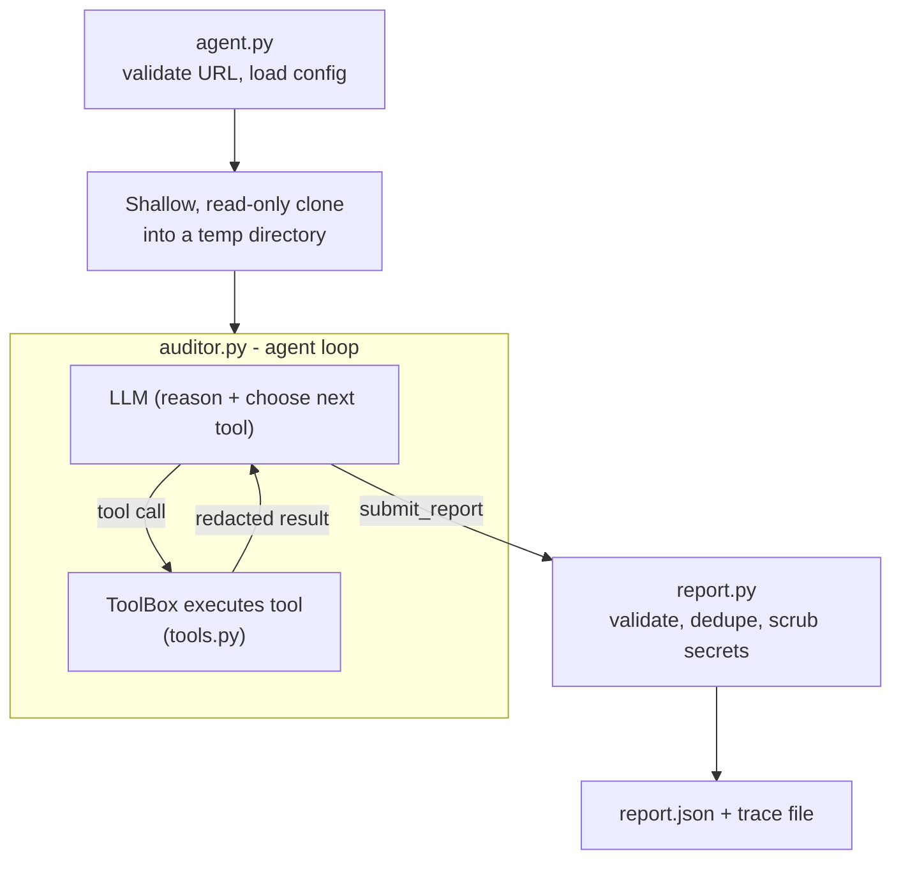

# DevOps Repository Auditing Agent

[](https://github.com/maimoona-i/devops-audit-agent/actions/workflows/ci.yml)

An autonomous, LLM-driven agent that audits a **public GitHub repository** for DevOps best-practice violations and
writes an evidence-based JSON report with actionable recommendations.

The LLM runs the investigation itself: it looks at what it has found so far, decides which inspection tool to call
next, interprets the result, follows up on leads, and finally submits its findings. There is **no fixed checklist** and
**no agent framework** (no LangChain, LangGraph, n8n or similar). The agent loop, tool dispatch and control flow are
plain Python; only the basic provider SDKs are used to reach the model.

> Course: MLOps & Production AI Engineering, Assignment 2. Scope: software engineering and DevOps only
> (no ML training, datasets or experiment tracking).

---

## Table of contents

1. [How it works](#how-it-works)
2. [Installation](#installation)
3. [Configuration](#configuration)
4. [Usage](#usage)
5. [Output format](#output-format)
6. [Inspection tools](#inspection-tools)
7. [Safety design](#safety-design)
8. [Reducing false positives](#reducing-false-positives)
9. [Reliability and error handling](#reliability-and-error-handling)
10. [Project structure](#project-structure)
11. [Tests and CI](#tests-and-ci)
12. [Limitations](#limitations)

---

## How it works

The agent follows the cycle **Observe → Reason → Select tool → Execute tool → Interpret results → Report**.



1. **Observe**: the first message gives the model only the repository URL. It starts by listing files.
2. **Reason and select a tool**: the model chooses the next tool and its arguments from everything seen so far. For
   example: a workflow runs `npm test`, so it checks whether `package.json` has a test script; it finds a suspicious
   value in one config file, so it searches the codebase for the same pattern.
3. **Execute**: `ToolBox` runs the tool in a read-only sandboxed checkout. Output is size-capped and secret-redacted.
4. **Interpret**: the result goes back to the model as a new observation. Tool errors are returned as text too, so the
   model can recover (for example by correcting a bad path).
5. **Report**: the model calls `submit_report` with findings. The code validates the submission and rejects malformed
   ones, asking the model to fix them.

Control-flow guarantees implemented in code (not left to the model):

- A **step budget** (`--max-steps`, default 30) and a **time budget** (`--max-seconds`, default 600). When either is
  exhausted, the model is forced to submit with what it has verified.
- If the model replies without calling a tool, it is nudged; after repeated failures the run exits with an error
  instead of inventing a result.
- Older tool output is trimmed to keep the context window bounded on large repositories.
- Every step (model reasoning text, tool name, arguments, result preview) is recorded in a **trace file**, so the
  tool-use behaviour can be inspected afterwards.

## Installation

Requirements: **Python 3.10+** and **git** on your PATH.

```bash
git clone https://github.com/maimoona-i/devops-audit-agent.git
cd devops-audit-agent

# recommended: isolated environment
python -m venv .venv
source .venv/bin/activate          # Windows PowerShell: .venv\Scripts\Activate.ps1

pip install -r requirements.txt
```

## Configuration

Credentials are read from environment variables, or from a local `.env` file (which is git-ignored).

```bash
cp .env.example .env               # Windows: copy .env.example .env
```

Then edit `.env`. Configure **one** provider:

| Variable | Purpose |
|---|---|
| `LLM_PROVIDER` | `anthropic` or `openai`. If empty, it is detected from whichever API key is set. |
| `LLM_MODEL` | Model name. If empty, a provider default is used. |
| `ANTHROPIC_API_KEY` | Key for the Anthropic API (provider `anthropic`). |
| `OPENAI_API_KEY` | Key for OpenAI **or any OpenAI-compatible service** (provider `openai`). |
| `OPENAI_BASE_URL` | Base URL of an OpenAI-compatible service. Leave empty for OpenAI itself. |
| `LLM_TIMEOUT` | Seconds to wait for each model response (default 90). Raise it for slow reasoning models. |

**Examples**

Anthropic:

```
LLM_PROVIDER=anthropic
ANTHROPIC_API_KEY=your-key
```

OpenAI:

```
LLM_PROVIDER=openai
OPENAI_API_KEY=your-key
LLM_MODEL=<an OpenAI model that supports tool calling>
```

Google Gemini (through its OpenAI-compatible endpoint):

```
LLM_PROVIDER=openai
OPENAI_API_KEY=your-gemini-key
OPENAI_BASE_URL=https://generativelanguage.googleapis.com/v1beta/openai/
LLM_MODEL=<a Gemini model your key can use>
```

Any model used must support **tool / function calling**. The agent also round-trips Gemini's "thought signatures"
that its OpenAI-compatible endpoint requires for multi-step tool use.

> Never commit `.env` or paste keys into code, logs or issues. Keys are never written to the report or trace.

## Usage

```bash
python agent.py --repo https://github.com/<owner>/<repo> --output report.json
```

| Option | Description |
|---|---|
| `--repo URL` | **Required.** Public GitHub repository URL. |
| `--output PATH` | **Required.** Where to write the JSON report. |
| `--provider {anthropic,openai}` | Override `LLM_PROVIDER`. |
| `--model NAME` | Override `LLM_MODEL`. |
| `--max-steps N` | Maximum agent steps (default 30). |
| `--max-seconds S` | Wall-clock budget for the investigation (default 600). |
| `--trace PATH` | Trace file location (default: `<output>.trace.json`, e.g. `report.trace.json`). |
| `--quiet` | Suppress progress output on stderr. |

The run is fully unattended: no interactive prompts. Progress is printed to **stderr**, for example:

```
[step 1] tool: list_files({})
[step 2] tool: inspect_workflows({})
[step 3] tool: read_file({"path": ".github/workflows/ci.yml"})
[step 7] submit_report: 5 violation(s)
```

**Exit codes**

| Code | Meaning |
|---|---|
| 0 | Inspection completed and a valid report was written (the `violations` array may be empty). |
| 2 | Fatal error with a message on stderr: invalid URL, clone failure, missing or invalid credentials, repeated LLM/API failure, model never submitted a report. No report is written. |
| 1 | Unexpected internal error (set `AGENT_DEBUG=1` to see the traceback). |

## Output format

```json
{
  "repository": "https://github.com/example/demo-project",
  "violations": [
    {
      "rule_id": "SEC-001",
      "category": "security",
      "severity": "critical",
      "file": "config.py",
      "line": 17,
      "description": "Hardcoded API credential",
      "evidence": "Credential assigned directly in source code",
      "recommendation": "Use a secrets manager or environment variable"
    }
  ]
}
```

- Every violation has all eight fields. `severity` is one of `critical`, `high`, `medium`, `low`.
- `file` and `line` are JSON `null` when not applicable (for example a missing README).
- `category` is one of: `repository_hygiene`, `dependency_management`, `code_quality`, `testing`, `ci_cd`,
  `security`, `configuration`, `collaboration`, `build_release`.
- A healthy repository yields `"violations": []`.
- **Secret values are never reproduced**: they are masked in tool output before the model sees them, and scrubbed
  again from the final report.
- Findings are sorted by severity. The report is written atomically (temp file, then rename), so a crash never leaves
  a half-written file.

The trace file (`<output>.trace.json`) is a separate record of the investigation: the model's reasoning notes, every
tool call with arguments, result sizes and previews, and run statistics.

`sample_report.json` in this repository is genuine output produced by this agent on a test repository.

## Inspection tools

| Tool | Purpose |
|---|---|
| `list_files(path, pattern)` | Discover files and structure, optionally filtered by sub-directory or glob. |
| `read_file(path, start_line, max_lines)` | Read a text file with line numbers, in chunks if long. |
| `search_code(pattern, file_glob, ignore_case)` | Regex search over text files; returns `file:line: text`. |
| `git_log(max_count)` | Recent commit history and total commit count. |
| `tracked_ignored_files()` | Committed files that the repo's own `.gitignore` says to ignore, plus tracked files that look generated, temporary or local (`__pycache__`, `.env`, logs, build output, IDE settings). |
| `inspect_workflows()` | Parses every GitHub Actions workflow and reports facts: triggers, permissions, jobs, steps, action pinning, `continue-on-error`, `if: false`, untrusted `github.event` values in `run:` scripts, `pull_request_target` with PR checkout. |
| `submit_report(violations)` | Terminal tool: ends the investigation with the findings. |

Tools report **facts**. Whether a fact is a real defect is the model's judgement, which is how equivalent solutions
(for example a lockfile of a different package manager) are recognised instead of being flagged blindly.

## Safety design

The agent inspects untrusted repositories, so it is built to be read-only and contained:

- **Never executes repository code.** Inspection is static (file reads, regex search, `git log`, YAML parsing). Tests
  and linters of the target are not run, because that would require real sandboxing.
- **Read-only checkout.** The repository is cloned shallowly (last 200 commits) into a private temporary directory
  with git hooks disabled, submodules not fetched and file-protocol cloning blocked. The directory is deleted
  afterwards. The inspected repository is never modified.
- **Path safety.** Requested paths cannot escape the repository root; `..` traversal is refused and symlinks are not
  followed.
- **Secret redaction at the source.** Every string returned by a tool passes through a redactor that masks common
  token formats (AWS, GitHub, Slack, Google, OpenAI-style keys), private-key blocks, connection-string passwords and
  `password/secret/token = "..."` assignments, while leaving references such as `os.environ[...]` or
  `${{ secrets.X }}` readable. The final report is scrubbed again.
- **Input validation.** Only `https://github.com/<owner>/<repo>` URLs are accepted; whitespace and shell
  metacharacters are rejected before any command runs.
- **Prompt-injection resistance.** The system prompt tells the model that repository content is untrusted data and
  must never be followed as instructions. The model has no tool that can write, execute or reach the network.
- **Bounded resources.** Caps on file size, listing size, search results and output length; timeouts on clone, git
  commands and model requests.

## Reducing false positives

Precision matters as much as recall. The agent is instructed and structurally constrained to:

- Treat an **absent optional file as a defect only if no equivalent exists** (lint config in `pyproject.toml`,
  `tox.ini`, `.pre-commit-config.yaml` or a CI step; other package managers' lockfiles; tests in any common layout).
- **Never infer remote settings** such as branch protection or required reviews from repository files.
- Ignore placeholders and references (`changeme`, `os.environ[...]`, `${{ secrets.X }}`) when judging credentials.
- Report only what it directly observed with a tool; **line numbers come from tool output**, and the report validator
  clears any line number that does not exist in the cited file.
- Drop findings with no evidence, merge duplicates, and return `[]` for a healthy repository instead of padding.

## Reliability and error handling

- Missing files, bad regexes, oversized files and bad tool arguments return an error **to the model as an observation**;
  they never crash the run.
- Model API calls retry with exponential backoff on rate limits, timeouts and 5xx errors; authentication and
  model-name errors fail fast with a helpful message.
- Invalid or missing credentials, unreachable or private repositories, and malformed URLs exit with code 2 and a clear
  message. No misleading report is produced when an inspection cannot complete.

## Project structure

```
agent.py          CLI entry point (arguments, exit codes, report + trace output)
auditor.py        Agent loop: reasoning turns, tool dispatch, budgets, submission handling
llm.py            Provider layer for Anthropic and OpenAI-compatible APIs, retries, message conversion
prompts.py        System prompt (investigation method, evidence rules, rule catalogue) and submit_report schema
tools.py          Sandboxed inspection tools, secret redaction, URL validation, ToolBox dispatcher
report.py         Report validation, normalisation, deduplication, atomic writing
tests/            Automated tests (tools, agent behaviour, report contract, LLM layer, CLI)
sample_report.json  Authentic example output
requirements.txt  Dependencies
.env.example      Required variable names (no real credentials)
.github/workflows/ci.yml   Lint + tests on every push and pull request
```

## Tests and CI

```bash
python -m pytest -q
ruff check .
```

The suite runs with **no network and no API key**:

- `tests/test_tools.py`: tools against a throwaway git repository with planted defects (secret masking, traversal
  and symlink refusal, workflow analysis, URL validation, read-only guarantee).
- `tests/test_auditor.py`: the agent loop driven by a scripted fake LLM, including a model whose next tool choice
  depends on the previous observation, budget enforcement, invalid submissions and secret leakage.
- `tests/test_report.py`: output contract, normalisation, deduplication, scrubbing, atomic writes.
- `tests/test_llm.py`: message conversion for both providers, retries, configuration errors.
- `tests/test_cli.py`: end-to-end runs and failure exit codes with the network and LLM replaced by fakes.

Some tests that create symlinks are skipped automatically on systems where symlinks are not permitted (for example
Windows without Developer Mode). GitHub Actions runs lint and the full suite on every push and pull request, with
read-only token permissions.

## Limitations

- **Static analysis only.** Tests, linters and builds of the target are not executed, so claims about failing tests
  or build errors rest on static evidence only.
- **Current files and recent history.** The clone is shallow (last 200 commits) and `git_log` shows commit subjects,
  so secrets that were committed and later deleted are not examined.
- **Repository files only.** Branch protection, required reviews, repository secrets and other GitHub settings are
  invisible to the agent, and it does not report on them.
- **Model dependence.** Findings come from an LLM, so runs can differ slightly even at temperature 0, and quality
  depends on the chosen model. Models must support tool calling.
- **Rate limits.** One audit makes roughly 10 to 30 model requests; free-tier API keys may hit quotas on large
  repositories (the agent retries transient errors with backoff).
- **Scope.** Public GitHub repositories only; very large files (over about 200 KB) are searched but not read in
  full.